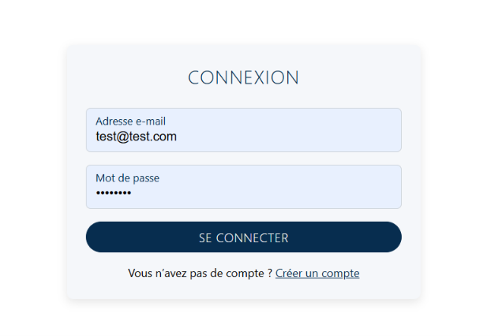
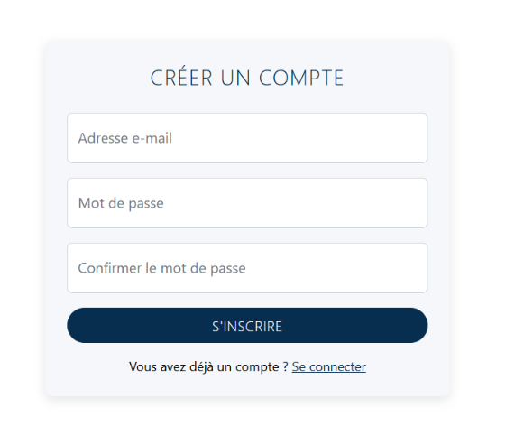
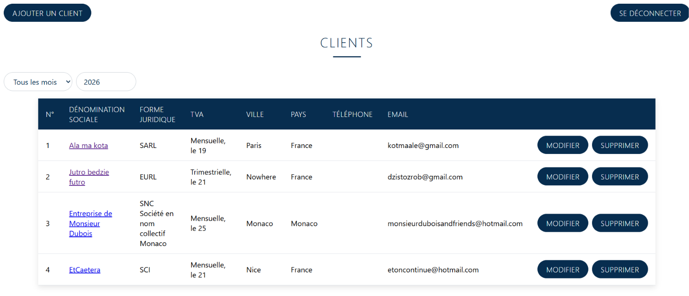
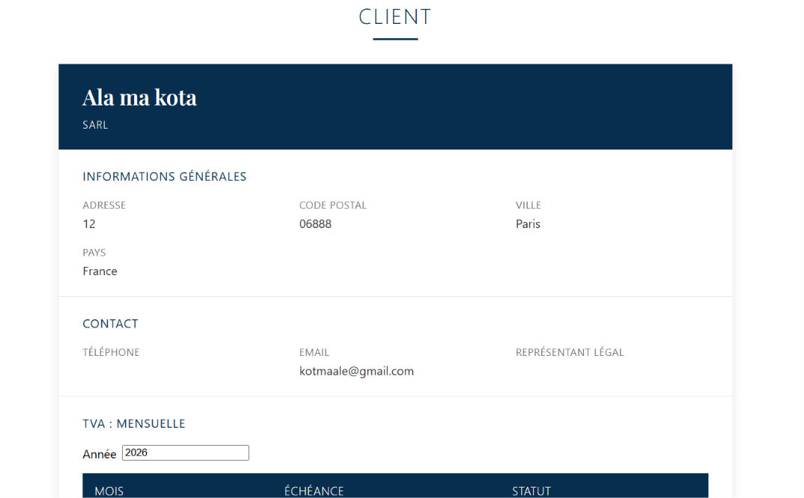
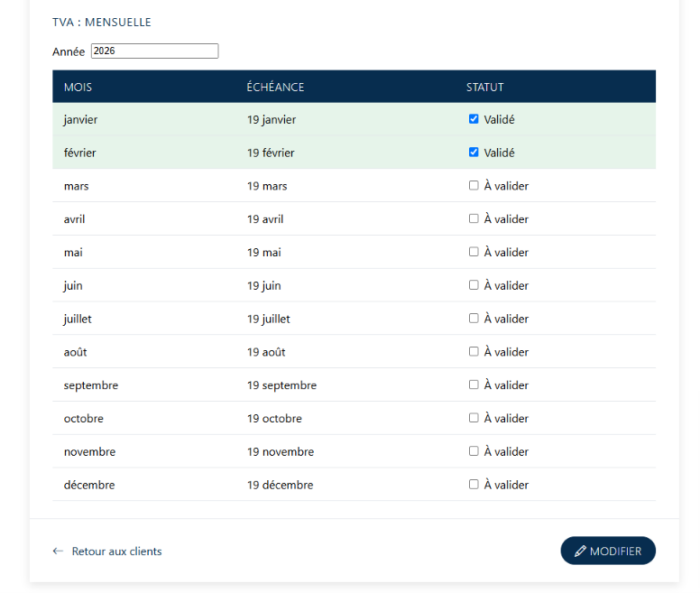

# MyApp — Gestion de clients et suivi de la TVA

> **Projet en cours de développement.**  
> Cette application évolue régulièrement avec l'ajout de nouvelles fonctionnalités.

Application web de **gestion de clients** et de **suivi des échéances de TVA**.

Un utilisateur connecté peut consulter la liste et les fiches des clients. Un administrateur dispose en plus des fonctionnalités de gestion des clients et du suivi de la TVA : ajout, modification, suppression et validation des déclarations mois par mois.

Le projet se compose d'un **front-end Angular** et d'une **API ASP.NET Core** reliée à **SQL Server**.

---

## Fonctionnalités

### 🔐 Authentification

- Inscription
- Connexion / déconnexion
- ASP.NET Core Identity
- Authentification par jeton **Bearer**
- Gestion des rôles :
  - `Admin`
  - `Utilisateur`

### 👥 Gestion des clients

- Consultation de la liste des clients
- Consultation de la fiche détaillée d'un client
- Ajout d'un client — **Admin**
- Modification d'un client — **Admin**
- Suppression d'un client — **Admin**
- Contrôle des accès :
  - côté Angular avec des **guards**
  - côté API avec `[Authorize]`

### 🏢 Formes juridiques

Les formes juridiques françaises et monégasques sont disponibles dans le formulaire de création et de modification :

- SARL
- SAS
- SCI
- SA
- SAM
- etc.

### 🧾 Suivi de la TVA

Pour chaque client :

- périodicité :
  - Mensuelle
  - Trimestrielle
  - Non concerné
- jour de déclaration :
  - 19
  - 20
  - 21
  - 24
  - 25

Les mois sans échéance sont automatiquement indiqués comme **« Non concerné »**.

### 📅 Filtre par mois et par année

Le système permet de filtrer les clients selon leur échéance de TVA.

Seuls les clients ayant une échéance sur la période sélectionnée sont affichés, avec la date correspondante.

**Exemple :**

```text
21/01/2026
```

### ✅ Validation de la TVA

L'administrateur peut marquer la TVA d'un client comme **« Validée »** pour un mois donné.

### 📊 Vue annuelle par client

Pour chaque client, une vue annuelle présente les douze mois de l'année avec leur statut :

- ✅ Validé
- ⏳ À valider
- — Non concerné

---

## Aperçu

### Connexion



### Inscription



### Liste des clients



### Fiche client



### Suivi de la TVA



---

## Technologies

| Partie | Technologies |
|---|---|
| **Front-end** | Angular 20, composants standalone, Signals, mode zoneless, rendu serveur, SCSS |
| **API** | ASP.NET Core 8, Entity Framework Core 8, ASP.NET Core Identity |
| **Base de données** | SQL Server Express |
| **Documentation API** | Swagger / Swashbuckle |

---

## Architecture du projet

```text
MyApp/
│
├── MyApp.api/
│   ├── Controllers/
│   ├── Models/
│   ├── Migrations/
│   └── ...
│
├── myapp/
│   └── src/
│       └── app/
│           ├── login/
│           ├── register/
│           ├── clients/
│           ├── client-detail/
│           ├── client-form/
│           ├── guards/
│           ├── interceptors/
│           └── services/
│
└── readme/
    ├── connexion.png
    ├── inscription.png
    ├── page1.png
    ├── client.png
    └── tva.png
```

### Organisation de l'application Angular

```text
myapp/src/app/

├── login/             # Page de connexion
├── register/          # Création de compte
├── clients/           # Liste des clients et filtre TVA
├── client-detail/     # Fiche client et vue annuelle de la TVA
├── client-form/       # Formulaire d'ajout et de modification
├── guards/            # Protection des routes
├── interceptors/      # Ajout du jeton aux requêtes HTTP
└── services/          # Communication avec l'API
```

---

# Installation

## Prérequis

Avant de commencer, installer :

- [.NET 8 SDK](https://dotnet.microsoft.com/download/dotnet/8.0)
- [Node.js 20.19+ ou 22.12+](https://nodejs.org/)
- Angular CLI
- SQL Server ou SQL Server Express

Installation d'Angular CLI :

```bash
npm install -g @angular/cli
```

---

## 1. API ASP.NET Core

Les fichiers `appsettings.json` ne sont pas versionnés dans le dépôt.

Créer le fichier :

```text
MyApp.api/appsettings.json
```

avec la configuration suivante :

```json
{
  "Logging": {
    "LogLevel": {
      "Default": "Information",
      "Microsoft.AspNetCore": "Warning"
    }
  },
  "ConnectionStrings": {
    "DefaultConnection": "Server=localhost\\SQLEXPRESS;Database=MyAppDb;Trusted_Connection=True;TrustServerCertificate=True;MultipleActiveResultSets=True"
  },
  "AllowedHosts": "*"
}
```

### Créer la base de données

Depuis le dossier de l'API :

```bash
cd MyApp.api
dotnet ef database update
```

Puis lancer l'API :

```bash
dotnet run --launch-profile http
```

L'API est disponible à l'adresse :

```text
http://localhost:5115
```

Swagger :

```text
http://localhost:5115/swagger
```

### Entity Framework Core

Si `dotnet ef` n'est pas installé :

```bash
dotnet tool install --global dotnet-ef
```

Dans Visual Studio, la commande équivalente est :

```powershell
Update-Database
```

---

## 2. Application Angular

Dans un autre terminal :

```bash
cd myapp
npm install
ng serve -o
```

L'application Angular est alors disponible à :

```text
http://localhost:4200
```

L'adresse de l'API est configurée dans :

```text
myapp/src/app/services/auth.service.ts
myapp/src/app/services/client.service.ts
```

---

# Compte administrateur

Au démarrage, l'API crée le rôle `Admin` et attribue ce rôle au compte :

```text
test@test.com
```

si ce compte existe.

Cette configuration se trouve dans `Program.cs` et peut être adaptée.

### Pour obtenir un compte administrateur

1. Créer le compte depuis la page d'inscription.
2. Arrêter puis redémarrer l'API.
3. Se reconnecter.

> Le rôle est enregistré dans le jeton lors de la connexion. Il est donc nécessaire de se reconnecter après l'attribution du rôle.

### Règles du mot de passe

Le mot de passe doit contenir au minimum :

- 6 caractères
- une majuscule
- une minuscule
- un chiffre
- un caractère spécial

---

# API — Points d'accès

| Méthode | Route | Accès |
|---|---|---|
| `POST` | `/register` | Public |
| `POST` | `/login` | Public |
| `GET` | `/api/account/me` | Utilisateur connecté |
| `GET` | `/api/client` | Utilisateur connecté |
| `GET` | `/api/client/{id}` | Utilisateur connecté |
| `GET` | `/api/client/formes-juridiques` | Utilisateur connecté |
| `GET` | `/api/client/periodicites-tva` | Utilisateur connecté |
| `POST` | `/api/client` | Admin |
| `PUT` | `/api/client/{id}` | Admin |
| `DELETE` | `/api/client/{id}` | Admin |
| `PUT` | `/api/client/{id}/tva-validation` | Admin |

### Paramètres de filtrage

La liste des clients accepte notamment les paramètres :

```text
/api/client?annee=2026&mois=1
```

La fiche client peut également recevoir une année :

```text
/api/client/1?annee=2026
```

---

# Règles de gestion de la TVA

## TVA mensuelle

Une échéance est générée **chaque mois** au jour choisi.

Exemple :

```text
Jour : 21

Janvier     → 21/01/2026
Février     → 21/02/2026
Mars        → 21/03/2026
...
Décembre    → 21/12/2026
```

## TVA trimestrielle

Une échéance est générée uniquement en :

- janvier
- avril
- juillet
- octobre

Exemple avec le jour 21 :

```text
21/01/2026
21/04/2026
21/07/2026
21/10/2026
```

Les autres mois sont automatiquement considérés comme **« Non concerné »**.

## Non concerné

Aucune échéance de TVA n'est générée.

---

# Exemple de vue annuelle

Pour un client soumis à la TVA trimestrielle :

| Mois | Statut |
|---|---|
| Janvier | ✅ Validé |
| Février | — Non concerné |
| Mars | — Non concerné |
| Avril | ⏳ À valider |
| Mai | — Non concerné |
| Juin | — Non concerné |
| Juillet | ⏳ À valider |
| Août | — Non concerné |
| Septembre | — Non concerné |
| Octobre | ⏳ À valider |
| Novembre | — Non concerné |
| Décembre | — Non concerné |

---

# État du projet

🚧 **Projet en cours de développement**

De nouvelles fonctionnalités sont régulièrement ajoutées et l'application continue d'évoluer.

---

## Objectifs du projet

Ce projet me permet notamment de mettre en pratique :

- le développement d'une API REST avec **ASP.NET Core**
- **Entity Framework Core**
- **ASP.NET Core Identity**
- l'authentification **Bearer / JWT**
- la gestion des rôles et des autorisations
- le développement d'une application **Angular moderne**
- les **Standalone Components**
- les **Signals**
- le mode **zoneless**
- la communication Angular ↔ API REST
- la gestion d'une base de données **SQL Server**
- la conception de règles métier autour du suivi de la TVA
- la documentation d'une API avec **Swagger**